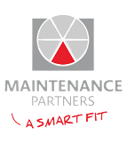

# Rotor Balancing

A desktop GUI tool (Python/Tkinter) for **single-plane rotor balancing** using the classic **influence coefficient method**, with a polar vector plot of the initial run, trial run, and resultant (effect) vector.



## Current status

| Tab | Status |
|---|---|
| **Single Plane** | ✅ Implemented — full influence-coefficient calculation + polar plot |
| **Two Plane** | 🚧 Placeholder tab only, no logic yet |
| **Help / Program info** | 🚧 Placeholder tabs, no content yet |

So despite the repo name implying broader scope, today this is a **single-plane balancing calculator**. Two-plane (and the multi-speed / three-plane cases referenced in the code comments) are not implemented — contributions welcome.

## What it does

Classic vibration-based rotor balancing with one trial weight:

1. **Initial run** — measure baseline vibration vector `O` (amplitude + phase) with the rotor unbalanced.
2. **Trial run** — add a known trial weight, measure the new vibration vector `O+T`.
3. **Effect vector** `T = (O+T) - O` — the tool computes this as a complex-number subtraction.
4. **Influence coefficient (IFC)** = trial weight / |T|, with the phase offset between the trial weight angle and the effect vector's phase.
5. **Heavy spot** = initial vibration vector × influence coefficient (this is the unbalance relative to the trial weight's reference frame).
6. **Correction weight** = magnitude of the heavy spot, at a phase **180° opposite** the heavy spot — this is the mass/angle to add to cancel the original unbalance.

All vector math is done with Python's `cmath`/`numpy` (magnitude–phase ↔ complex-number conversions), and the three key vectors (Initial Run, Trial Run, Resultant) are drawn on a polar plot for a visual sanity check. A separate "Graph" button opens a more detailed polar plot including the trial weight and correction weight positions.

## Requirements

- Python 3.8+
- See `requirements.txt`: `numpy`, `matplotlib`, `scipy`
- `tkinter` and `cmath` are part of the Python standard library (on Windows, `tkinter` ships with the standard CPython installer; on Linux install `python3-tk` via your package manager if it's missing)

## Running it

```bash
python -m venv venv
venv\Scripts\activate        # Windows
# source venv/bin/activate   # Linux/macOS
pip install -r requirements.txt
python Rotor_Balancing.py
```

## Using the Single Plane tab

1. Run the rotor unbalanced. Record vibration **amplitude (mm/s)** and **phase angle (°)** → enter as **Initial Run**.
2. Stop, attach a known **trial weight** (grams) at a known angle, note both in the **Trial Weight** fields.
3. Run again with the trial weight attached. Record the new amplitude/phase → enter as **Trial Run**.
4. Click **Calculate**. The tool fills in:
   - **IFC** (influence coefficient): magnitude (mm/s per gram) and phase (°)
   - **Correction Weight**: mass (grams) and angle (°) to add to the rotor to balance it
5. Click **Graph** for a detailed polar plot of all vectors, or **Reset** to clear all fields.
6. **Help** pre-fills the fields with a worked example (initial run 5.6 mm/s @ 135°, trial run 3.3 mm/s @ 238°, trial weight 74 g @ 315°) so you can see the method work end to end without a real rotor.

> **Sign convention:** phase angles are measured per your own vibration analyzer's convention (typically relative to a keyphasor/trigger mark, increasing in the direction of rotation or against it depending on the instrument). Keep the same convention for initial run, trial run, and trial weight placement, or the correction weight angle will be wrong. This tool does not know your analyzer's convention — verify on a known case (e.g. the Help example) before trusting it on real equipment.

## Known limitations

- Single trial weight / single plane / single speed only — no multi-plane, multi-speed, or least-squares overdetermined solutions.
- No input validation — non-numeric entries will raise an uncaught exception.
- No save/export of results; polar plots are just `matplotlib` figures with no file export hooked up.
- `angle_plot.py` and `resize.py` are standalone demo/scratch scripts (angle-arc annotation and a `scipy.optimize.leastsq` curve-fit example) — they are not imported by `Rotor_Balancing.py` and are kept here as reference snippets, not part of the application.

## Disclaimer

This is an engineering calculation aid, not a certified instrument. Verify results against your vibration analyzer's own balancing module or hand calculation before using correction weights on real rotating equipment. Field balancing carries real risk (mechanical damage, personnel safety) if trial/correction weights are sized or placed incorrectly — follow your site's rotating equipment safety procedures.

## License

MIT — see [LICENSE](LICENSE).
