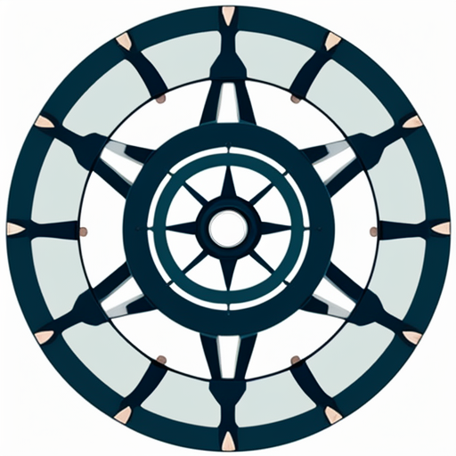

# Rotor Balancing Workbench

A local Python/Tkinter engineering aid for single-plane and multi-plane/multi-speed influence-coefficient balancing. `Rotor_Balancing.py` launches the workbench; on Windows, `Launch_Rotor_Balancing.cmd` is the double-click launcher for the repository’s `.devvenv`. This is not a certified instrument or standards-compliance implementation. See the [user guide](docs/USER_GUIDE.md) and [source-backed references](docs/references.md).

The app includes **Single plane** and **Multi-plane / multi-speed** modes. Both use four stages: baseline, sequential trial runs, proposed correction with plots, and verification/trim. The multi-plane mode supports up to 8 planes, probes and speeds. See the user guide for operating procedure, model assumptions, plot legends, trim interpretation and safety caveats.

The **Standards & tolerances** tab calculates the G-based residual-unbalance allowance and compares entered measured vibration against a user-provided agreed limit at nominal rpm. It supplies **no current ISO vibration-zone tables** and does not establish acceptance or compliance. Balance grade G is not measured vibration; no universal rpm-to-mm/s limit exists.



## Run locally

Requires Python with Tkinter and the packages in `requirements.txt`: NumPy, Matplotlib, SciPy and Pillow. On Windows, double-click `Launch_Rotor_Balancing.cmd` to launch using the repository’s `.devvenv` (it must already exist). For a new environment, use:
python -m venv venv
venv\Scripts\activate        # Windows
# source venv/bin/activate   # Linux/macOS
pip install -r requirements.txt
python Rotor_Balancing.py
```

The **Help: load worked example** buttons provide deterministic synthetic teaching inputs, not machine measurements. The app is local and does not persist job records; maintain an external run sheet.

## Engineering caveats

Influence coefficients are an empirical local linear approximation. Comparable conditions, safe trial masses, consistent radius and phase conventions, full column rank and acceptable conditioning are essential. Least squares can trade off performance among channels; inspect each predicted residual. Predictions are not measured results. The trim calculation takes the actual installed net correction and fresh vibration measurements, returns an incremental proposal, and shows the candidate net total. Verify changes by measurement; do not treat a proposal as installed or accepted.

Use qualified engineering review and applicable controlled standards, machine-specific criteria and site safety procedures. See [docs/references.md](docs/references.md) for standard scope, current-edition notes and research references.

## Development checks

```bash
pip install -r requirements-dev.txt
pytest tests/ -v
```

## License

MIT — see [LICENSE](LICENSE).
